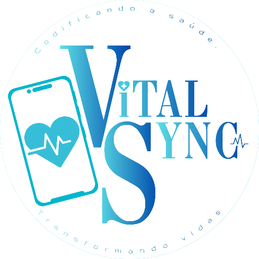
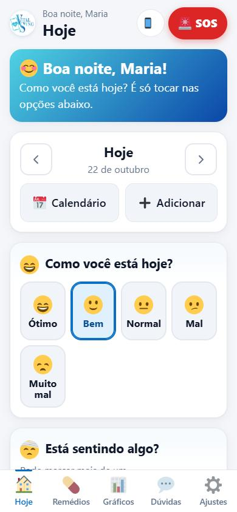
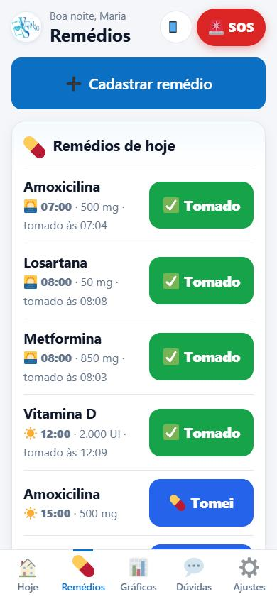
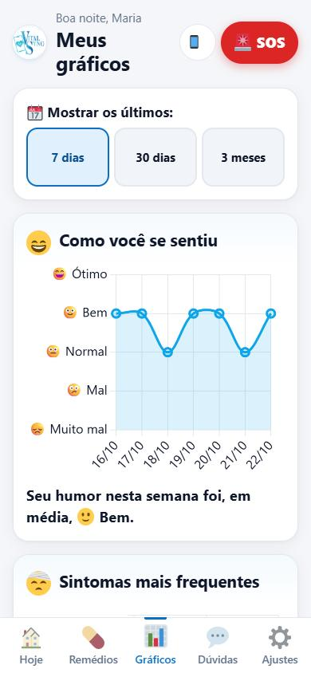
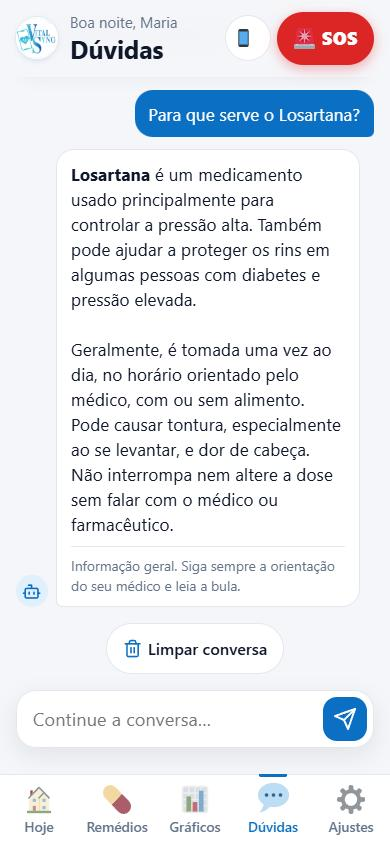
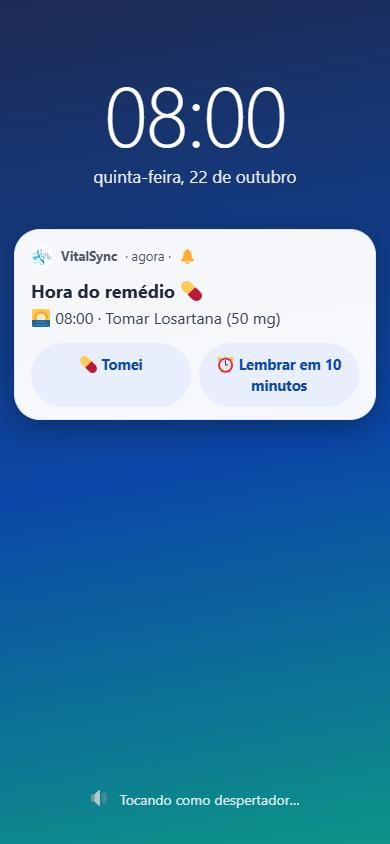

  

<h1 align="center">VitalSync</h1>

<em>Coding health. Transforming lives.</em>

  <a href="https://vitalsync-96876.web.app"><b>🌐 Live website</b></a> ·
  <a href="#-english">English</a> ·
  <a href="#-português">Português</a>

  
  
  
  
  
  

  
  
  
  
  

---

## 🇺🇸 English

**VitalSync** is an Android health app that helps people of all ages — especially older adults and people who struggle with typing — take their medication on time, track symptoms, and bring organized data to their doctor.

> This repository is a **code showcase**: it contains the most complex modules of the app and the full source of the download website. The complete app source is kept private.

### Key features
- **Medication alarms** that ring like an alarm clock, with *"I took it"* and *"Remind me in 10 min"* buttons right on the notification.
- **Offline-first cloud sync** with Google sign-in — works without internet and syncs automatically when the connection returns.
- **AI health assistant** (OpenAI or Gemini) that answers questions using the user's own context (medications, symptoms, mood).
- **Tap-based daily check-in**: mood, symptoms with intensity, sleep and water — almost no typing needed.
- **Charts** (7 days / 30 days / 3 months) for mood, symptoms, adherence, sleep and water.
- **Accessibility**: adjustable font and icon size (auto-suggested by age), high contrast, dark mode.
- **3 languages**: Portuguese, English and Spanish, with an automated check for missing translations.
- **SOS button**: emergency number and emergency contact in one tap.

### What's in this repo
| File | What it shows |
|---|---|
| [`src/sync-engine.js`](src/sync-engine.js) | Offline-first sync engine: per-record change detection with hashing, last-write-wins conflict resolution, in-flight request de-duplication, upload with timeout, merge on pull. |
| [`src/cloud.js`](src/cloud.js) | Firebase layer: native Google sign-in on Android vs. popup on web, Firestore offline persistence, batched deletes. |
| [`firestore.rules`](firestore.rules) | Security rules — each user can only read and write their own data. |
| [`src/med-scheduler.js`](src/med-scheduler.js) | Medication plans (fixed times or every X hours, continuous or for N days) and the native notification scheduler: alarm channels, action buttons, snooze, Android 12+ exact-alarm permission, notification caps. |
| [`src/ai-assistant.js`](src/ai-assistant.js) | AI chat with two providers, user-context prompt, retry with backoff on 429/5xx, 45 s timeout, cancellation with `AbortController`, native HTTP on Android to avoid CORS. |
| [`src/i18n.js`](src/i18n.js) + [`tools/check-i18n.js`](tools/check-i18n.js) | Lightweight i18n (interpolation + plurals) and a script that validates that all 3 languages have the same keys. |
| [`site/`](site/) | Download landing page (HTML/CSS/JS, trilingual), hosted on Firebase Hosting, with an in-app update check via `version.json`. |

### Tech stack
Vanilla JavaScript (no framework) · HTML5 / CSS3 · Capacitor 8 (Android) · Firebase Authentication + Cloud Firestore · Firebase Hosting · Chart.js · OpenAI / Google Gemini APIs · Node.js tooling scripts

### Technical highlights
- **No framework, ~3,400 lines of hand-written app logic** with a single render loop and bottom-sheet UI system.
- **Two storage modes** chosen by the user: *hybrid* (phone + cloud) or *cloud-only* (no health data stored on the device).
- **Reliable notifications**: everything is rescheduled from scratch on each change (debounced), keeping pending snoozes, so the schedule is always consistent with the data.
- **Privacy by design**: Firestore rules isolate each user; AI context is sent only for the current request.

### My role
VitalSync was built by a team (developer, designer, project manager, solutions architect and QA).
**I was the developer** — responsible for programming the app and its features, the cloud sync, notifications, AI integration and the website.

---

## 🇧🇷 Português

**VitalSync** é um app Android de saúde que ajuda pessoas de todas as idades — principalmente idosos e quem tem dificuldade para digitar — a tomar os remédios na hora certa, acompanhar sintomas e levar informações organizadas para a consulta médica.

> Este repositório é uma **vitrine de código**: traz os módulos mais complexos do app e o código completo do site de download. O código completo do aplicativo é privado.

### Principais funcionalidades
- **Alarme dos remédios** que toca como despertador, com os botões *"Tomei"* e *"Lembrar em 10 min"* na própria notificação.
- **Sincronização com a nuvem offline-first** com login Google — funciona sem internet e sincroniza sozinho quando a conexão volta.
- **Assistente de saúde com IA** (OpenAI ou Gemini) que responde usando o contexto do usuário (remédios, sintomas, humor).
- **Registro diário por toques**: humor, sintomas com intensidade, sono e água — quase sem digitar.
- **Gráficos** (7 dias / 30 dias / 3 meses) de humor, sintomas, remédios tomados, sono e água.
- **Acessibilidade**: tamanho de letra e ícones ajustável (sugerido pela idade), alto contraste e modo escuro.
- **3 idiomas**: português, inglês e espanhol, com verificação automática de traduções faltando.
- **Botão SOS**: número de emergência e contato de emergência com um toque.

### O que tem neste repositório
| Arquivo | O que mostra |
|---|---|
| [`src/sync-engine.js`](src/sync-engine.js) | Motor de sincronização offline-first: detecção de mudanças por registro com hash, resolução de conflitos "o mais recente vence", envio sem duplicar requisições, upload com tempo limite e mesclagem ao baixar. |
| [`src/cloud.js`](src/cloud.js) | Camada do Firebase: login Google nativo no Android e popup na web, persistência offline do Firestore, exclusão em lotes. |
| [`firestore.rules`](firestore.rules) | Regras de segurança — cada usuário só lê e grava os próprios dados. |
| [`src/med-scheduler.js`](src/med-scheduler.js) | Planos de remédio (horários fixos ou de X em X horas, contínuo ou por N dias) e agendador de notificações nativas: canais de alarme, botões de ação, soneca, permissão de alarme exato do Android 12+ e limites de notificações. |
| [`src/ai-assistant.js`](src/ai-assistant.js) | Chat com IA em dois provedores, prompt com contexto do usuário, novas tentativas em erros 429/5xx, tempo limite de 45 s, cancelamento com `AbortController` e HTTP nativo no Android para evitar CORS. |
| [`src/i18n.js`](src/i18n.js) + [`tools/check-i18n.js`](tools/check-i18n.js) | Tradução leve (variáveis + plural) e um script que confere se os 3 idiomas têm as mesmas chaves. |
| [`site/`](site/) | Site de download (HTML/CSS/JS, em 3 idiomas), hospedado no Firebase Hosting, com aviso de nova versão no app via `version.json`. |

### Tecnologias
JavaScript puro (sem framework) · HTML5 / CSS3 · Capacitor 8 (Android) · Firebase Authentication + Cloud Firestore · Firebase Hosting · Chart.js · APIs da OpenAI / Google Gemini · scripts em Node.js

### Destaques técnicos
- **Sem framework, ~3.400 linhas de lógica escritas à mão**, com um único ciclo de renderização e um sistema próprio de telas em "folhas" (bottom sheets).
- **Dois modos de armazenamento** escolhidos pelo usuário: *híbrido* (celular + nuvem) ou *só nuvem* (nenhum dado de saúde fica no aparelho).
- **Notificações confiáveis**: tudo é reagendado do zero a cada mudança (com debounce), mantendo as sonecas pendentes — a agenda sempre bate com os dados.
- **Privacidade desde o projeto**: regras do Firestore isolam cada usuário; o contexto enviado à IA vale só para aquela pergunta.

### Meu papel
O VitalSync foi feito em equipe (desenvolvedor, designer, gestor de projeto, arquiteto de soluções e QA).
**Eu fui o desenvolvedor** — responsável pela programação do app e das funcionalidades, sincronização com a nuvem, notificações, integração com IA e o site.

---

© Pedro Henrique Siqueira Fagundes. All rights reserved · Todos os direitos reservados.

